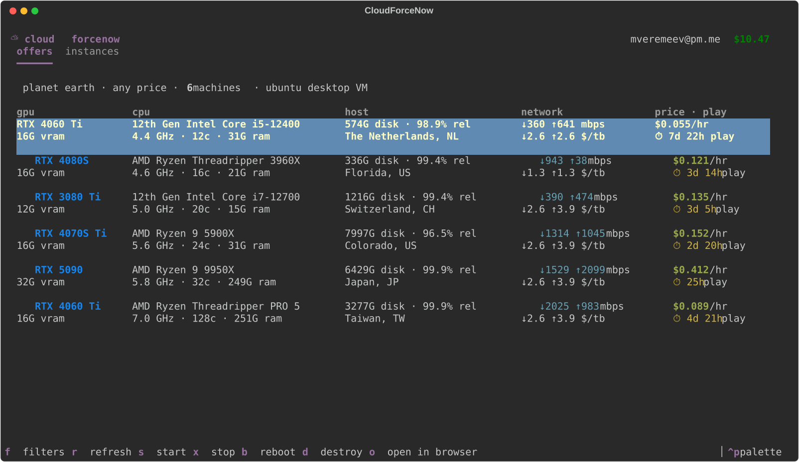
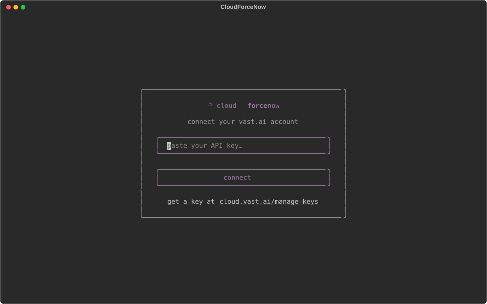
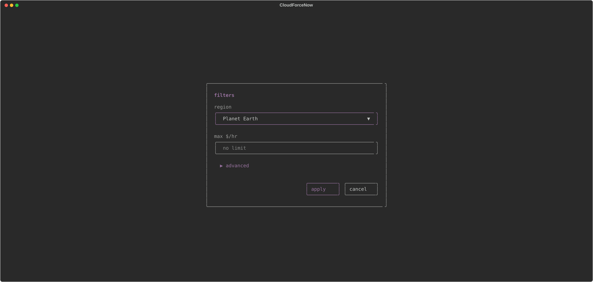
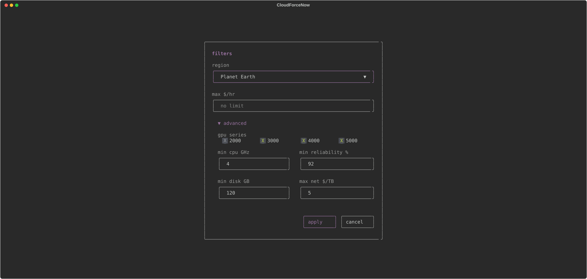
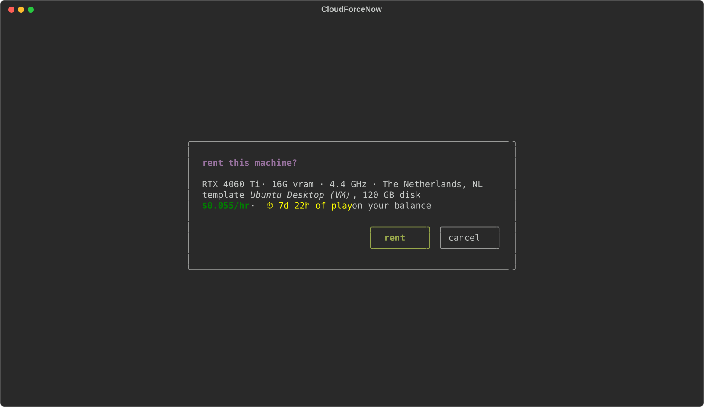
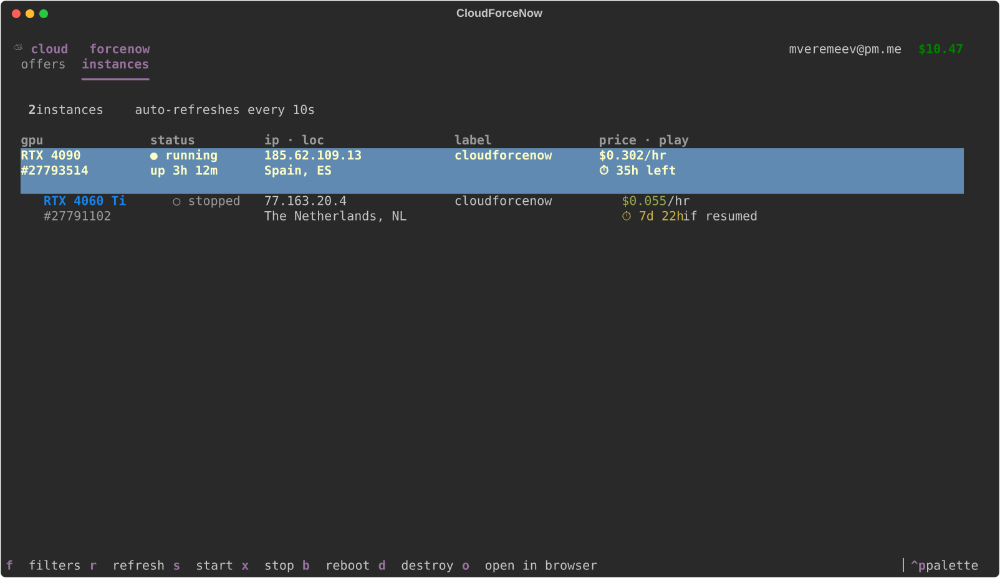

# ⛅ CloudForceNow

A pretty little TUI for finding, renting and managing GPU machines on
[Vast.ai](https://vast.ai) — your personal cloud gaming / desktop rig, one
keypress away.



## What it does

- **Login** with your Vast.ai API key (get one at
  [cloud.vast.ai/manage-keys](https://cloud.vast.ai/manage-keys/)). Verified
  against the API, then stored in `~/.config/cloudforcenow/config.json`
  (chmod 600).
- **Browse offers** matching the defaults:
  - 1× RTX 3000 / 4000 / 5000-series GPU
  - CPU ≥ 4 GHz, reliability ≥ 92%, disk ≥ 120 GB
  - internet up/down ≤ $5/TB
  - VM-capable hosts, launched with the **Ubuntu Desktop (VM)** template

  Each offer is a compact two-line entry (with a blank line between
  entries) — GPU + VRAM, CPU model with
  clock/cores/RAM, disk + reliability + location, network speed and cost —
  ending in the price column: **$/hr** on the first line and **⏱ time of
  play** (how long your current balance lasts on that machine) on the
  second. Cheapest first; the table stretches to fill the terminal width,
  and everything including the price fits without a horizontal scrollbar
  on terminals ≥ ~115 columns.
- **Filters** (`f`): region (same list as the web UI) and max $/hr in a small
  modal, persisted between runs. Under **advanced** you can change the rest of
  the constraints — GPU series (2000 / 3000 / 4000 / 5000 toggles; 2000 is
  available but off by default), min CPU GHz, min reliability %, min disk GB,
  and max network $/TB. Region, price and machine count show as a one-line
  summary above the table.
- **Rent** the highlighted machine with `enter` → confirm dialog (price and
  time of play included) → instance spins up from the Ubuntu Desktop (VM)
  template.
- **Manage instances**: two-line entries with live status (● running /
  ◐ starting / ○ stopped / ✗ offline, auto-refreshed every 10 s), uptime,
  and **⏱ time left** on your balance while running. Start `s`, stop `x`,
  reboot `b`, destroy `d` (with a red confirm), and `o` to open the
  instance page on cloud.vast.ai in your browser.

## Install & run

```sh
python3 -m venv .venv && .venv/bin/pip install -e .
.venv/bin/cfn
```

## Keys

| key | action |
|-----|--------|
| `←` / `→` (or `1` / `2`) | switch between offers and instances |
| `f` | edit filters (region, max $/hr) |
| `r` | refresh current view |
| `enter` | rent highlighted offer |
| `s` `x` `b` | start / stop / reboot instance |
| `d` | destroy instance (confirms) |
| `o` | open cloud.vast.ai/instances in browser |
| `ctrl+q` | quit |

## Screens

| login | filters | advanced | rent | instances |
|-------|---------|----------|------|-----------|
|  |  |  |  |  |

## Notes

- Vast.ai prices internet transfer in **$/GB** at the API level; the UI (and
  this app) shows the friendlier **$/TB** — the preset's "≤ 5" means $5/TB.
- The Ubuntu Desktop (VM) template hash is resolved by name on first rent and
  cached in the config; delete `template_hash` from the config to re-resolve.
- Stopping an instance pauses GPU billing (storage still bills). Restarting
  needs that host's GPU to be free, so a stopped instance can occasionally be
  stuck waiting — that's a Vast.ai marketplace property, not a bug here.
